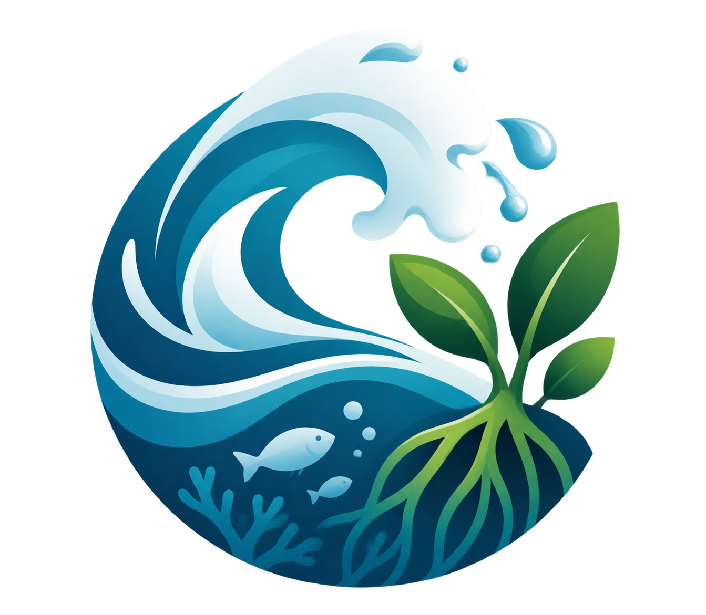

# Jaga Pesisir
Website Konservasi Laut dan Pantai
SDG 13 dan 14

## Anggota Kelompok 
1. Maherhany Audrey Mellolo - 2515091142 - Pengembangan halaman Beranda, navbar, dan footer.
2. Ni Nyoman Yishe Rahayuning - 2515091080 - Pengembangan halaman Edukasi dan artikel.
3. Komang Trisna Laksmi Ananda Putri - 2515091149 - Pengembangan halaman Panduan dan Tentang. 

## Deskripsi Website 
   - Tujuan : Membangun website edukasi JagaPesisir untuk meningkatkan kesadaran masyarakat tentang pentingnya menjaga                   kebersihan dan kelestarian lingkungan pesisir, serta mendorong kepedulian terhadap ekosistem laut dan pantai.
   - Manfaat : 1. Memberikan informasi dan edukasi mengenai kebersihan serta kelestarian lingkungan pesisir.
               2. Menambah pengetahuan pengguna tentang pentingnya menjaga ekosistem pesisir.
               3. Menyediakan panduan dan artikel yang dapat menjadi sumber informasi bagi masyarakat.
               4. Mendorong masyarakat untuk menerapkan perilaku yang peduli terhadap lingkungan pesisir.
   - Sasaran Pengguna : Website JagaPesisir ditujukan kepada masyarakat umum, khususnya pelajar, mahasiswa, dan generasi                           muda yang ingin mempelajari pentingnya menjaga kebersihan dan kelestarian lingkungan pesisir.

## Halaman Website
- Beranda : Halaman Beranda (index.html) dirancang sebagai halaman utama website JagaPesisir yang memperkenalkan tujuan website serta mengajak pengunjung untuk lebih peduli terhadap kebersihan dan kelestarian lingkungan pesisir. Halaman ini menjadi titik awal bagi pengguna untuk mengenal informasi yang tersedia dan mengakses halaman lainnya melalui navigasi website. Dari sisi implementasi, halaman ini dibuat menggunakan HTML5 untuk menyusun struktur konten dan CSS3 untuk mengatur tampilan visual, seperti tata letak, tipografi, warna, gambar, serta jarak antarelemen. Halaman Beranda juga dilengkapi dengan navbar untuk memudahkan perpindahan halaman, bagian utama (hero section) untuk menampilkan pengenalan website, serta footer sebagai bagian penutup halaman. Pengaturan CSS digunakan untuk menjaga konsistensi tampilan dan memberikan pengalaman penggunaan yang nyaman bagi pengunjung.
  
- Edukasi : Halaman Edukasi (edukasi.html) dirancang untuk memberikan informasi dan meningkatkan pemahaman pengunjung mengenai pentingnya menjaga kelestarian lingkungan pesisir. Konten halaman ini membahas permasalahan lingkungan, khususnya sampah laut, dampaknya terhadap ekosistem, serta pentingnya upaya pelestarian laut. Informasi yang disajikan bertujuan meningkatkan kesadaran pengunjung agar lebih peduli terhadap kebersihan dan keberlanjutan lingkungan pesisir. Dari sisi implementasi, halaman ini dibuat menggunakan HTML5 untuk menyusun struktur konten dan CSS3 untuk mengatur tampilan, termasuk bagian pengenalan halaman (hero), kartu informasi edukasi, serta bagian penutup. Penggunaan komponen kartu membantu menyajikan informasi secara terstruktur agar lebih mudah dibaca dan dipahami.

- Panduan : Halaman Panduan (panduan.html) dirancang untuk memberikan arahan dan langkah-langkah praktis kepada pengunjung mengenai cara menjaga kebersihan dan kelestarian lingkungan pesisir. Halaman ini menyajikan informasi yang dapat diterapkan dalam kehidupan sehari-hari, seperti mengurangi penggunaan plastik, membuang sampah pada tempatnya, serta ikut berpartisipasi dalam menjaga kebersihan pantai. Dari sisi desain, halaman ini menggunakan identitas visual JagaPesisir dengan perpaduan warna biru laut dan hijau yang mencerminkan kepedulian terhadap lingkungan. Implementasi halaman menggunakan HTML5 untuk menyusun struktur konten dan CSS3 untuk mengatur tata letak, warna, tipografi, serta elemen visual agar informasi panduan mudah dibaca dan dipahami pengunjung.
  
- Artikel : Halaman Artikel (artikel.html) dirancang sebagai sarana untuk menyajikan artikel dan informasi tambahan mengenai lingkungan pesisir. Halaman ini menggunakan judul utama “Artikel dan Inspirasi Pesisir” untuk memperkenalkan konten yang berkaitan dengan ekosistem pesisir dan upaya pelestariannya. Dari sisi desain, bagian pengenalan halaman menggunakan kombinasi warna biru laut dan hijau mangrove yang sesuai dengan identitas visual JagaPesisir, serta aksen warna aqua sebagai elemen pendukung. Implementasi halaman menggunakan HTML5 untuk menyusun struktur konten dan CSS3 untuk mengatur tata letak, warna, tipografi, serta elemen visual. Halaman ini diharapkan dapat membantu pengunjung memperoleh informasi tambahan dan menambah wawasan mengenai pentingnya menjaga kelestarian lingkungan pesisir
  
- Tentang : Halaman Tentang (tentang.html) dirancang untuk memperkenalkan website JagaPesisir, termasuk tujuan pembuatan website dan pentingnya meningkatkan kesadaran masyarakat terhadap kebersihan serta kelestarian lingkungan pesisir. Halaman ini memberikan gambaran mengenai peran JagaPesisir sebagai media informasi dan edukasi yang mendorong pengunjung untuk lebih peduli terhadap ekosistem laut dan pesisir. Dari sisi desain, halaman ini menggunakan elemen visual yang selaras dengan identitas website, seperti perpaduan warna biru laut dan hijau yang menggambarkan lingkungan pesisir. Implementasi halaman menggunakan HTML5 untuk menyusun struktur informasi dan CSS3 untuk mengatur tampilan, tata letak, warna, tipografi, serta elemen pendukung lainnya sehingga informasi mengenai JagaPesisir dapat disampaikan secara jelas dan terstruktur.
  
## Teknologi
Teknologi yang digunakan dalam pengembangan website ini meliputi:
- HTML5 untuk menyusun struktur halaman website.
- CSS3 untuk mengatur tampilan dan desain website.
- Flexbox dan CSS Grid untuk membantu pengaturan tata letak.
- CSS Media Queries untuk mendukung desain responsif pada berbagai ukuran layar.
- Git dan GitHub untuk pengelolaan versi kode dan kolaborasi kelompok.
  
## Penjelasan Implementasi
Website **JagaPesisir** dikembangkan menggunakan HTML5, CSS3, dan JavaScript untuk menyampaikan informasi edukatif mengenai kebersihan, perlindungan, dan pelestarian lingkungan pesisir. Website terdiri atas lima halaman utama, yaitu Beranda, Edukasi, Panduan, Artikel, dan Tentang Kami. Setiap halaman memiliki fungsi informasi yang berbeda, tetapi menggunakan identitas visual dan navigasi yang konsisten.

1. Navigasi Website
Navigasi digunakan untuk memudahkan pengunjung berpindah antarhalaman. Menu navigasi menghubungkan lima halaman utama melalui elemen tautan HTML (`<a>`). Logo JagaPesisir juga dapat diklik untuk kembali ke halaman Beranda.

Contoh implementasi HTML:

```html
<header class="navbar">
    <a href="index.html" class="logo">
        
        JagaPesisir
    </a>

    <nav aria-label="Navigasi utama">
        <a href="index.html">Beranda</a>
        <a href="edukasi.html">Edukasi</a>
        <a href="panduan.html">Panduan</a>
        <a href="artikel.html">Artikel</a>
        <a href="tentang.html">Tentang Kami</a>
    </nav>
</header>
```

Elemen `<header>` berfungsi sebagai bagian kepala halaman, sedangkan `<nav>` mengelompokkan tautan navigasi. Atribut `aria-label` membantu menjelaskan fungsi navigasi kepada teknologi bantu. Kelas CSS digunakan untuk mengatur tampilan logo, posisi menu, jarak antaritem, dan penanda halaman aktif.

### 2. Layout dan Konsistensi Tampilan

Pengaturan tampilan dipusatkan dalam file `css/style.css`. Penggunaan satu stylesheet membantu menjaga konsistensi warna, tipografi, jarak, tombol, navigasi, footer, dan komponen ajakan pada seluruh halaman.

Layout konten menggunakan container agar lebar teks dan elemen halaman tetap teratur. Beberapa bagian informasi menggunakan kartu dan grid untuk menyusun materi edukasi, artikel, serta informasi pendukung agar mudah dibaca.

Contoh implementasi bagian ajakan:

```html
<section class="closing container">
    <div>
        <p class="eyebrow">MULAI DARI DIRI SENDIRI</p>
        <h2>Laut yang bersih dimulai dari kita.</h2>
        <p>Temukan aksi sederhana yang bisa kamu lakukan setiap hari.</p>
    </div>

    <a href="panduan.html" class="button closing-button">
        Lihat Panduan →
    </a>
</section>
```

Bagian tersebut berfungsi mengajak pengunjung melakukan tindakan nyata sekaligus mengarahkan mereka menuju halaman Panduan. Kelas `closing`, `container`, dan `closing-button` menghubungkan struktur HTML dengan aturan tampilan di stylesheet.

### 3. Footer dan Navigasi Tambahan

Footer digunakan untuk menampilkan identitas website, deskripsi singkat, serta tautan ke halaman lainnya. Struktur footer dibuat konsisten pada setiap halaman agar pengunjung tetap dapat menemukan navigasi ketika mencapai bagian bawah website.

Contoh implementasi HTML:

```html
<footer class="footer">
    <div class="container footer-content">
        <div>
            <a href="index.html" class="logo">
                
                JagaPesisir
            </a>

            <p>
                Website edukasi untuk mengenali, melindungi,
                dan melestarikan laut serta ekosistem pesisir.
            </p>
        </div>

        <div class="footer-links">
            <h3>Jelajahi Website</h3>
            <a href="index.html">Beranda</a>
            <a href="edukasi.html">Edukasi</a>
            <a href="panduan.html">Panduan</a>
            <a href="artikel.html">Artikel</a>
            <a href="tentang.html">Tentang Kami</a>
        </div>
    </div>
</footer>
```

Kelas `footer-content` digunakan untuk mengatur susunan isi footer, sedangkan `footer-links` mengelompokkan tautan navigasi tambahan. Pengaturan tampilannya diseragamkan melalui `css/style.css`.

### 4. Responsive Design

Desain responsif diterapkan melalui CSS media queries agar susunan konten dapat menyesuaikan ukuran layar. Pada layar yang lebih kecil, jumlah kolom pada grid dikurangi dan beberapa layout kartu diubah menjadi satu kolom. Pengaturan ini membantu menjaga keterbacaan teks, ukuran elemen, dan kenyamanan navigasi pada perangkat seluler.

Contoh implementasi CSS:

```css
@media (max-width: 800px) {
    .article-page .infographic-grid {
        grid-template-columns:
            repeat(2, minmax(0, 1fr));
    }
}

@media (max-width: 550px) {
    .education-page .education-card,
    .article-page .article-feature {
        grid-template-columns: 1fr;
    }
}
```

Pada lebar layar maksimal 800 piksel, grid infografik artikel disusun menjadi dua kolom. Pada lebar maksimal 550 piksel, kartu edukasi dan bagian artikel unggulan menggunakan satu kolom. Dengan demikian, konten tetap tersusun dengan baik pada layar yang lebih sempit.

### 5. Struktur HTML dan Pengelolaan Aset

Setiap halaman menggunakan elemen HTML semantik seperti `<header>`, `<nav>`, `<main>`, `<section>`, dan `<footer>` untuk membedakan fungsi setiap bagian. Tautan antarhalaman menggunakan nama file HTML, sedangkan logo dan gambar disimpan dalam folder `images` dan dipanggil melalui alamat relatif.

Pemisahan struktur HTML dan aturan CSS mempermudah proses pemeliharaan website. Perubahan tampilan umum dapat dilakukan melalui `css/style.css`, sementara perubahan isi informasi dilakukan pada file HTML halaman terkait. Pendekatan ini membuat pengembangan dan perbaikan website lebih terorganisasi.

## Struktur Folder
JagaPesisir/
- .vscode/
- css/
- images/
- index.html
- edukasi.html
- panduan.html
- artikel.html
- tentang.html
- README.md

Penjelasan :

- .vscode/: Folder untuk menyimpan konfigurasi pengembangan proyek di Visual Studio Code.
- css/: Folder untuk menyimpan file CSS yang mengatur tampilan website, seperti warna, tipografi, tata letak, dan desain responsif.
- images/: Folder untuk menyimpan aset gambar yang digunakan sebagai pendukung visual pada halaman website.
- index.html: File untuk menampilkan halaman Beranda sebagai halaman utama website JagaPesisir.
- edukasi.html: File untuk menampilkan informasi edukasi mengenai lingkungan pesisir dan pentingnya menjaga kelestarian laut.
- panduan.html: File yang berisi panduan atau langkah-langkah untuk menjaga dan melestarikan lingkungan pesisir.
- artikel.html: File untuk menampilkan artikel terkait lingkungan pesisir dan upaya pelestariannya.
- tentang.html: File yang berisi informasi mengenai website JagaPesisir dan tujuan pembuatannya.
- README.md: File dokumentasi proyek yang memuat deskripsi website, anggota kelompok, teknologi yang diguna
## Website dan Repository
- URL GitHub Pages: https://hannyaudreyy.github.io/JagaPesisir/
- URL repository: https://github.com/hannyaudreyy/JagaPesisir

## Referensi
1. Sumber informasi :
   
   a. edukasi
   - Kementerian Kelautan dan Perikanan (KKP) — Laut Sebasah — [Link sumber informasi](https://www.kkp.go.id/news/news-detail/laut-sebasah-upaya-nyata-menyelamatkan-laut-indonesia-nR3R.html)
  - United Nations — SDG 13: Climate Action — [Link sumber informasi](https://sdgs.un.org/goals/goal13)
  - United Nations — SDG 14: Life Below Water — [Link sumber informasi](https://sdgs.un.org/goals/goal14)
   b. artikel
   - Kementerian Kelautan dan Perikanan (KKP) — Laut Sebasah — [Link sumber informasi](https://www.kkp.go.id/news/news-detail/laut-sebasah-upaya-nyata-menyelamatkan-laut-indonesia-nR3R.html)
   c. tentang
   - UNEP [Link sumber informasi](https://www.unep.org/en)
   - NOAA Marine Debris [Link sumber informasi](https://marinedebris.noaa.gov/)
   - FAO Mangrove [Link sumber informasi](https://www.fao.org/forestry/mangrove/en/)


2. Sumber Gambar :
   
a. Logo Navbar dan Footer (Semua Halaman)
- logo.png — [Link sumber gambar]((https://canva.link/bfvxa33njwhc3x5))

b. Beranda (`index.html`)
- mangrove.jpg — [Link sumber gambar](https://id.pinterest.com/pin/1108378158263744062/)
- memungut sampah.jpg — [Link sumber gambar](https://id.pinterest.com/pin/194991858856872542/)
- ombak pantai.jpg — [Link sumber gambar](https://id.pinterest.com/pin/1103030133790022391/)
- ombak.jpg — [Link sumber gambar](https://id.pinterest.com/pin/838865868131210104/)
- pantai.jpg — [Link sumber gambar](https://id.pinterest.com/pin/986077280928734453/)
- pemandangan mangrove.jpg — [Link sumber gambar](https://id.pinterest.com/pin/4610982440475435648/)
- recycle logo.jpg— [Link sumber gambar](https://id.pinterest.com/pin/677580706478422920/)

c. Edukasi (`edukasi.html`)
- pencemaran-laut.jpg — [Link sumber gambar](https://indomgb.s3.amazonaws.com/wp-content/uploads/2018/12/22070321/2.-Sampah-plastik-di-laut-Gorontalo.jpg)
- sampah-pantai.jpg — [Link sumber gambar](https://img.antaranews.com/cache/1200x800/2021/12/09/antarafoto-dampak-cuaca-ekstrem-di-lampung-091221-ard-3-1.jpg)
- rehabilitasi-mangrove.jpg — [Link sumber gambar](https://indomgb.s3.amazonaws.com/wp-content/uploads/2022/11/22020824/PENANAMAN-MANGROVE-2-2048x1365.jpg)
- ekosistem-pesisir.jpg — [Link sumber gambar](https://jektvnews.disway.id/upload/c11b17716026c6fbbc007af9049e074c.jpg)
- keanekaragaman-laut.jpg — [Link sumber gambar](https://infokelautan.home.blog/wp-content/uploads/2019/06/1-6.jpg)

d. Panduan (`panduan.html`)
- kerang.jpg — [Link sumber gambar](https://pin.it/6vNoj9Ogk)
  
e. Artikel (`artikel.html`)
- pencemaran-laut2.jpg — [Link sumber gambar](https://unsplash.com/id/foto/pencemaran-laut-dengan-sampah-plastik-dan-rumput-laut-qx9zJYc177A)
- rehabilitasi-mangrove2.jpg — [Link sumber gambar](https://thumb.wikimedia.org/wikipedia/commons/thumb/0/0f/Tawsan_Protected_Mangrove_Forest.jpg/960px-Tawsan_Protected_Mangrove_Forest.jpg?utm_source=id.wikipedia.org&utm_campaign=parser&utm_content=thumbnail)

f. Tentang Kami (`tentang.html`)
- kids-cleanup.png — [Link sumber gambar](https://pin.it/6WOWkOhAb)


